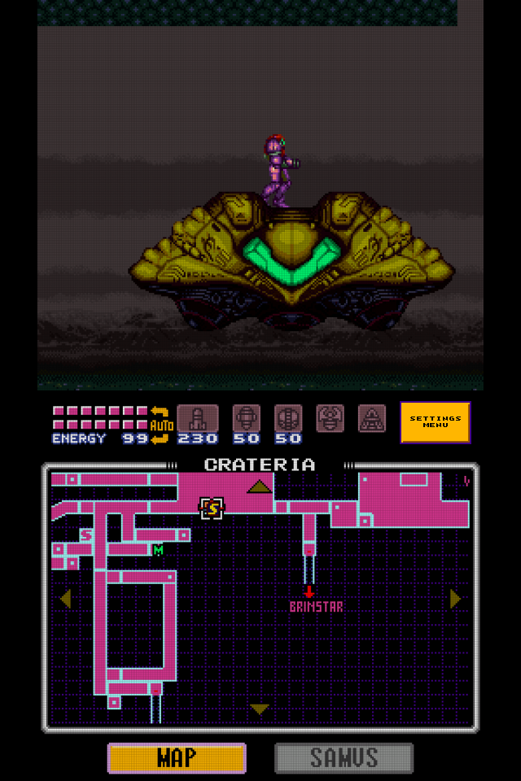
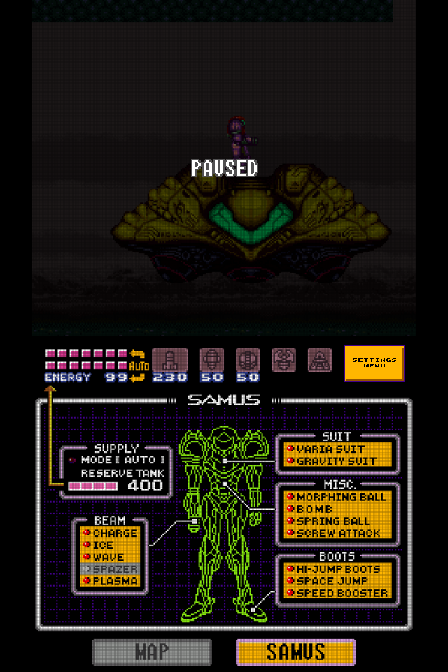
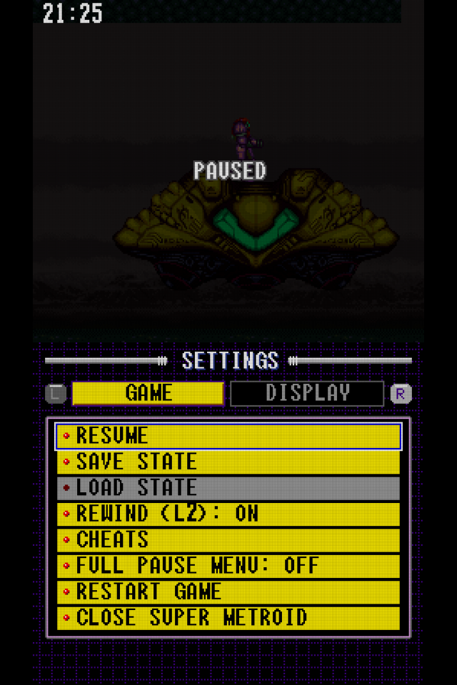
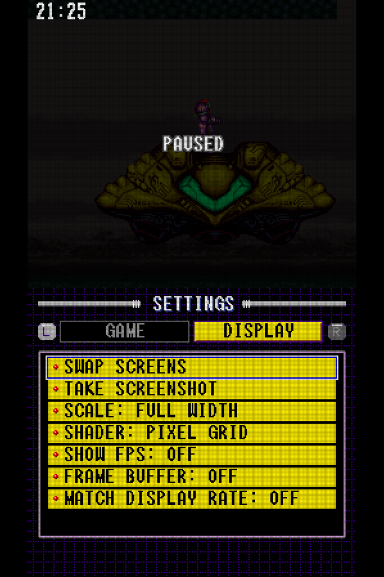

# Super Metroid DS

Super Metroid on dual-screen handhelds (the Anbernic RG DS / RG DS Plus), in
the style of [GBA DS](https://github.com/kyannon/gba-ds): the game on one
screen, and on the other its HUD and its own pause map, kept up to date while
you play.

| On the ship: the game above, the HUD and Crateria's map below | Paused (START): the game dimmed above, the SAMUS page below |
|---|---|
|  |  |
| **Settings: Game** | **Settings: Display** |
|  |  |

(Both screens of an RG DS, 640 x 480 each, with Scale: Full Width and Shader:
Pixel Grid.)

**v0.2** is for Linux handhelds: ROCKNIX and BananaOS on the RG DS / RG DS
Plus. Download `super-metroid-ds-v0.2-linux-aarch64.zip` from the
[releases](https://github.com/kyannon/super-metroid-ds/releases).

- **The game screen has no HUD bar.** The energy / ammo bar is taken off the
  top of the picture and the room shows through where it was.
- **The second screen** has the HUD bar at the top (energy, reserve tanks,
  missiles, super missiles, power bombs, grapple, X-ray, live as you play),
  and below it the pause screen, in two pages with a **MAP** and a **SAMUS**
  button at the bottom (tap one to switch; the page fades to black and back
  in, as the game's own pause screen does):
  - **MAP**: the pause screen's map of the area you're in, refreshed every
    1.5 s and whenever you enter a room.
  - **SAMUS**: the equipment screen. Tap a suit, item, boot or beam to switch
    it on or off, or MODE to switch the reserve tanks between AUTO and
    MANUAL; it takes effect in the game at once (Samus's colours, beam and
    the HUD's AUTO sign included). Spazer and plasma still don't go together.

  Both are captured from a hidden second copy of the game: your game is
  never paused for them. While the game couldn't be paused (a door, Ceres
  station, a cutscene, an item's message), the two buttons are greyed out
  and the page is dimmed.
  Tap an item icon in the HUD (missiles, super missiles, power bombs,
  grapple, X-ray) to select it at once; tap it again for none. SELECT still
  cycles through them as usual.
  Tap near an edge of the map (where the pause screen's arrows are) to scroll
  it that way, a step a tap or more while you hold; it goes back to Samus
  when you enter another room.
- Before there's a map to show (the intro, the title and file screens, Ceres
  station, where the game can't be paused, the cutscenes), the second screen
  says **MAP NOT AVAILABLE**.
- **START** pauses the game where it is (dimmed, PAUSED) rather than opening
  the pause screen, which is on the second screen; START again goes on. The
  MAP and SAMUS pages work while it's paused (equipment switched then takes
  effect when you go on). With one screen, or with **Full Pause Menu** on
  (Settings → Game), START opens the game's own pause screen as usual.
- Where the HUD's mini-map was, a **SETTINGS MENU** button (in the game's small lettering) opens the
  settings menu (HOME, or SELECT+START with `menu_combo`, open it too).
- Menus and messages are drawn in the Super Metroid font, in the colours and
  shapes of the game's pause screen.

## Install (ROCKNIX)

1. Unzip `super-metroid-ds-v<version>-linux-aarch64.zip` into `/storage/roms/ports/`.
2. Put your Super Metroid ROM (`.sfc` / `.smc`, the Japan / USA release) in
   `/storage/roms/ports/super-metroid-ds/` (or in `/storage/roms/snes/`).
   A RetroArch battery save (`.srm` with the same name as the ROM) next to it
   is used as it is.
3. Start **Super Metroid** from Ports.

The ROM isn't included: you need your own copy.

## Install (BananaOS)

[BananaOS](https://github.com/JorreFog/BananaLinux) runs it as a port, from the same zip:

1. Unzip it into the card's `roms/ports` folder (`/data/roms/ports` on the device).
2. Put the ROM in `roms/ports/super-metroid-ds/` or in Banana's SNES folder
   (`/data/roms/snes`, where its own SNES list finds it too).
3. In Banana's menu, open **Ports** and start **Super Metroid**.

Banana has no compositor, so the app opens a window on each panel and draws
them with the GPU straight onto the panels (SDL's KMS/DRM driver); touches on
the bottom panel work as on ROCKNIX. Banana's ports launcher switches the
bottom panel off; the app switches it back on while it runs. The zip has an
SDL mapping for the built-in controls (`gamecontrollerdb.txt`), since Banana
ships none. On Banana, battery saves go to `/data/saves` beside RetroArch's
(a `.srm` next to the ROM is carried over the first time), unless you've set
`save_dir` in `sm-ds.cfg`. The log is
`roms/ports/super-metroid-ds/sm-ds.log`.

If the panels stay dark or only one shows, other ways of reaching them can be
tried by adding a line near the top of `launch.sh`:
`export SMDS_BANANA_VIDEO=evdev` (one window over both panels, drawn by the
CPU: slower) or `export SMDS_BANANA_VIDEO=offscreen` (slower still).

## Controls

The SNES layout: A right, B bottom, X top, Y left face button; L / R the
shoulders. Hold L2 to rewind, R2 to fast-forward; L3 (pressing the left
stick) swaps the screens. HOME opens the settings menu; HOME + START quits,
HOME + R / L save / load a state, HOME + X shows the FPS, HOME + Y swaps the
screens.

Rewinding goes back a few minutes: it keeps a state every `rewind_step`
frames in `rewind_mb` megabytes (64 MB held about six minutes of play in
Crateria); `rewind = 0` turns it off.

## Settings

`sm-ds.cfg` next to the program (commented); choices made in the menu are kept in
`states/prefs.cfg`. The menu is drawn at the game's own resolution (256 x 224)
and scaled like the game, by the Scale setting. It has two pages (L / R or
tap the tabs):

- **Game**: Resume, Save State, Load State, Rewind, Cheats, Full Pause Menu (off: START just pauses; on: START opens the game's own pause screen, map and equipment, on the game screen), Restart Game, Close Super Metroid
- **Display**: Swap Screens, Take Screenshot, Scale (Pixel Perfect / Full Width / Zoom / Stretch), Shader (Off / Pixel Grid / Scanlines), Show FPS, Frame Buffer, Match Display Rate

**Cheats**: RetroArch `.cht` files in the `cheats` folder next to the program
(made on first launch; subfolders are read too, `cheat_dir` to change it) all
go into one list. Game → Cheats switches each on or off (D-pad and A, L / R a
page, B back; or tap, and drag to scroll); choices are kept in
`states/<game>.cheats`. See `cheats/README.txt`.

Leaving saves a resume state (`auto_resume`), loaded the next time. Take
Screenshot saves both screens, stacked, as a PNG in the `screenshots` folder
next to the program (`screenshot_dir` to change it).

## Building

- Desktop (development, tests): `scripts/setup-host.sh` (fetches snes9x and
  SDL2 into `deps/`), then `make` and `make tools`.
- ROCKNIX and BananaOS (aarch64): `scripts/build-rocknix.sh`, which fetches
  an aarch64 toolchain and produces the zip in `dist/`.

Testing without a screen:

    SDL_VIDEODRIVER=offscreen SDL_AUDIODRIVER=dummy SMDS_WINDOW=1024x1536 \
      build/host/sm-ds --state-dir=/tmp/st --load-state=X.st --input-script=SCRIPT game.sfc

Script lines are `TICK BUTTONS` (A, B+UP, - for none), `TICK SHOT:file.bmp`,
`TICK TAP:x,y` (fractions of the window), `TICK QUIT`; `tools/script.py`
writes them from relative steps (`wait N`, `hold BTNS N`, `shot FILE`,
`tap X,Y`, `quit`). A shot to a `.png` has every screen stacked, a `.bmp`
only the first window. `SMDS_DEBUG=1` logs map captures. Two windows (as on
BananaOS) can be tried on a desktop with one display: `SMDS_TEST_DUAL=1
--layout=dual --touch-map=screen` (an X11 display, e.g. `Xvfb`). `build/host/probe`
drives the core alone, frame by frame, and saves states the app can load.

## How it works

- **The SNES core** is snes9x's libretro core (`core/`: `snes9x.patch`, applied
  by the build scripts, and `smds_ext.cpp` for video RAM, the palette and the
  loaded ROM), built
  twice as `sm-core-a.so` (the game) and `sm-core-b.so` (the hidden copy) so
  the two copies don't share globals; `src/emu.c` loads them with `dlopen`.
- **The HUD patch** (`src/sm.c`): the game switches the screen to its HUD's
  settings with an interrupt at line 0 and back at line 31. Each "start of
  HUD" handler in the interrupt table is turned into a jump to its "end of
  HUD" partner (main gameplay, door transitions, Draygon's room), so the
  room's settings hold from the top. The game still draws the HUD into video
  RAM, and `sm_draw_hud` draws it from there (BG3's tiles and palette) for
  the second screen.
- **Keeping the strip right.** The game never had to draw that strip well, as
  the HUD covered it. Two more changes make it: when the screen scrolls up,
  the game drew the block row *below* the top one (the top one was hidden), so
  the top 16 lines showed stale tiles; it now draws the top row itself
  (`$80:A44E` / `$80:A486`, for the room and its background). And the game's
  HDMA tables (per-line scroll, BG mode, colour...) give the first 31 lines
  the HUD's own values: a change to snes9x (`core/snes9x.patch`, dma.cpp)
  has each channel write on those lines the values its table has for line 31,
  the first line of the room (the table itself runs on as usual). That keeps
  the sky's parallax and the falling rain going in the strip, and Ceres
  station, whose rooms switch to another BG mode below the HUD, is drawn in
  full (it showed garbage there). And sprite rows that wrap past line 255
  onto the top of the screen (pieces of things below the screen, like the
  gunship's underside) aren't drawn (gfx.cpp): the HUD used to hide them.
- **The map and the equipment screen** (`src/mapcap.c`): the hidden copy gets
  a snapshot of the game, START is pressed, and once the pause screen's map
  is up and fully faded in (game state $0F, brightness $0F), rows 32-198 (the
  area name and the map's frame) are copied, 12 frames 2 apart for the
  blinking markers. For the SAMUS page the hidden copy's pause screen opens
  on the equipment screen (`$82:8D2F` calls a routine at `$82:F800` that
  loads it), and 32 frames are kept for its 64-frame glow.
- **Switching equipment** (`src/sm.c`): a tap flips the item's bit in the
  game's RAM (`$09A2` items, `$09A6` beams, `$09C0` reserve mode) and sets
  `$7E:FFF0`; main gameplay's entry in the game-state table (`$82:8991`) now
  goes through `$82:F840`, which, when that's set, does what leaving the
  pause screen does: the suit palette (`$91:DEBA`), the beam's graphics
  (`$90:AC8D`), Samus's pose (`$91:E633`) and the HUD's AUTO sign.

## Licences

Super Metroid DS's own code is MIT (LICENSE).

The SNES core is [snes9x](https://github.com/snes9xgit/snes9x)'s libretro
core, whose licence allows use, changes and distribution for non-commercial
purposes only. So while this project's code is MIT, **the builds (which ship
the core) may only be distributed and used non-commercially**; commercial use
needs the snes9x authors' permission. Each build carries snes9x's licence
and where to find its source. snes9x's NTSC filter, which is LGPL, is left
out of the builds (`core/ntsc_stub.cpp` stands in for it).

The stb headers (public domain / MIT) and `src/libretro.h` (MIT) keep their own
terms. The Super Metroid font (`assets/fonts`) was supplied for this project.
Super Metroid is a trademark of Nintendo; this is a fan project, and no game
data is included: bring your own ROM.
